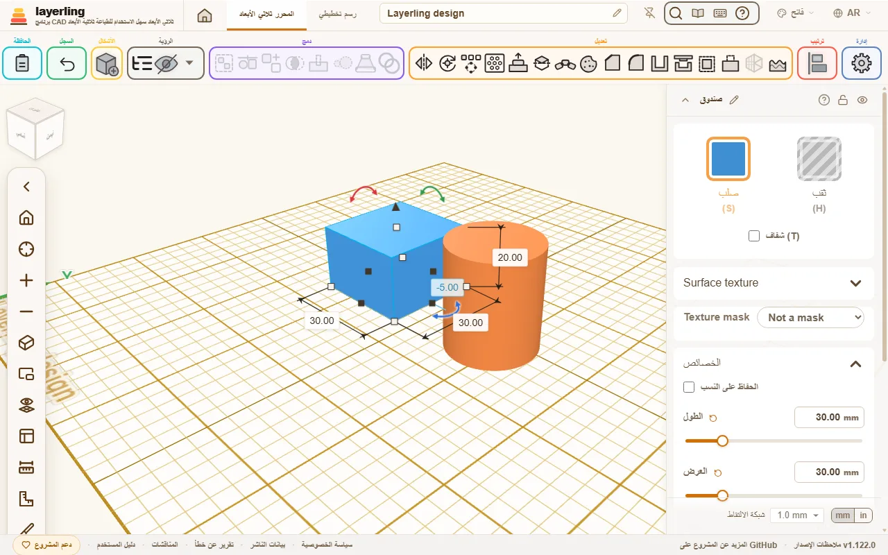

<div align="center">
  <table>
    <tr>
      <td width="145" align="center">
        
      </td>
      <td>
        <h1 align="right">layerling</h1>
        <h3 align="right">برنامج CAD ثلاثي الأبعاد سهل للطباعة ثلاثية الأبعاد</h3>
        <p align="right">
          ضع شكلًا، واقطع ثقبًا، ونعّم حافة، ثم اطبع. في متصفحك، دون حساب ودون خبرة سابقة في CAD.
        </p>
      </td>
    </tr>
  </table>

  <p>
    <a href="LICENSE"></a>
    
    
    <a href="#layerling-mcp-skill"></a>
  </p>

  <p><a href="README.md">English</a> · <a href="README.de.md">Deutsch</a> · <a href="README.nl.md">Nederlands</a> · <strong>العربية</strong> · <a href="README.zh-cn.md">简体中文</a> · <a href="README.zh-tw.md">繁體中文</a></p>
</div>

<p align="center">
  
</p>

<p align="center"><em>layerling في المتصفح</em></p>

<p align="center"><a href="https://layerling.com/dalil/index.html"><strong>دليل الاستخدام</strong></a>، خطوة بخطوة ومع الصور</p>

## لمن هو

لديك طابعة ثلاثية الأبعاد. وتريد قطعة تناسب شيئًا ما، لا مسيرة مهنية في CAD.

يعمل layerling بالطريقة التي تفكر بها أصلًا: ضع شكلًا على اللوحة، واسحبه إلى المقاس المطلوب، وحوّل شكلًا ثانيًا إلى ثقب، وجمّع الاثنين، ثم صدّر واطبع. لا شيء تتعلمه قبل أن تبدأ و**لا شيء تسجّل فيه** – افتح الصفحة وابنِ. تبقى تصاميمك في متصفحك أنت: لا حساب، ولا سحابة، ولا يُرفع شيء إلى أي مكان.

### قادم من Tinkercad؟

يقف layerling خطوة أبعد من Tinkercad باتجاه Fusion 360: يُستخدم بالطريقة نفسها، فستتعرف على كل شيء – اللوحة، والأشكال، والأجسام الصلبة والثقوب، والتجميع وفك التجميع، والحزمة، والسحب مع Alt لصنع نسخة – لكنه لا يتوقف حيث يتوقف Tinkercad. أشياء كنت تفتقدها تنتظرك:

- **الشطف والتنعيم.** اختر حافة واشطفها أو نعّمها – أكثر ما يطلبه الناس عندما يجب أن تبدو القطعة المطبوعة متقنة أو أن تنزلق في مكانها داخل شيء آخر. تبقى المعالجات المطبقة على الحواف قابلة للتغيير: أزل المعالجة مرة أخرى أو اضغط «تعديل» لتغيير قيمتها على الحواف نفسها.
- **التفريغ والتقسيم والرسم التخطيطي والأسنان اللولبية.** فرّغ جسمًا إلى جدار متساوي السمك، وقسّمه بمستوى، وارسم رسومات تخطيطية بأطوال وزوايا دقيقة ثم ابثقها أو حوّلها إلى أجسام دورانية، وأضف براغي وصواميل وثقوبًا ملولبة.
- **الأنماط واللف.** كرّر شكلًا في صف أو دائرة أو حلزون، أو لُفّ نمطًا أو نصًا حول أسطوانة.
- **أنماط الثقوب.** انقر على وجه مسطح ووزّع عليه ثقوبًا دائرية أو مربعة أو مستطيلة أو سداسية أو شقوقًا، في شبكة أو بصفوف متداخلة، مع التباعد والهامش والعمق - فتحات تهوية وشبكات سماعات وسلال في خطوة واحدة.
- **التكبير/التصغير بالنسبة المئوية.** كبّر قطعة واحدة أو عدة قطع أو صغّرها بنسبة مئوية - معًا، فيكبر الترتيب معها، أو كل واحدة في مكانها.
- **القياس والنظر إلى الداخل.** شريط قياس، ومساطر، وعرض المقطع الذي يفتح النموذج بالقطع، وشريط تمرير للسجل للعودة إلى حالات سابقة.
- **هندسة حقيقية في الأساس.** يحتفظ layerling بأشكال CAD دقيقة، لا بشبكة مثلثات فقط، فتبقى الحافة المنعّمة حافة منعّمة – حتى في ملف STEP لبرنامج CAD كامل.

ليس حزمة CAD كاملة: لا خط زمني بارامتري ولا تجميعات ميكانيكية (assemblies). ويمكنك **تشغيله بنفسك**: ثبّته كتطبيق (فيعمل بعدها دون إنترنت)، أو استضف نسختك الخاصة على Windows أو NAS أو خادم منزلي – انظر [البدء](#البدء).

> **يمكن للذكاء الاصطناعي أن يبني معك.** يأتي layerling مع خادم MCP. يرى عميل ذكاء اصطناعي مثل Gemini أو Claude أو Codex علامة تبويب
> مفتوحة للمحرر ويعمل فيها: يضيف أشكالًا، ويغيّر المقاسات، ويجمّع، ويقطع، وينعّم الحواف، ويقرأ المشهد، ويلتقط صورًا
> لمنطقة العرض. أنت تصف القطعة، والذكاء الاصطناعي يبنيها، وأنت تشاهد ذلك وتتدخل متى شئت. يعمل هذا
> محليًا، ولا يغادر شيء المتصفح – انظر [layerling MCP Skill](#layerling-mcp-skill) لطريقة الإعداد.

## ما الذي يفعله

### البناء

- **لوحة حقيقية** – شبكة، والتقاط، ومقابض للتحريك وتغيير الحجم والتدوير، ولوحة بالأرقام الدقيقة عندما تحتاج إليها.
- **اكتب موضعًا** – بطاقة «الموضع» تضع الجسم عند X وY وZ بدقة، ويمكن ركن القطع بجانب اللوحة، كما في Tinkercad.
- **أسهم المحاور** – أسهم حمراء وخضراء وزرقاء عند الزاوية الأمامية اليسرى من اللوحة تُظهر X وY وZ في اتجاه عدّ الأرقام، كما في Bambu Studio وOrcaSlicer؛ ويمكن إيقافها في الإعدادات.
- **محور دوران يبقى** – اضبط محور دوران لجسم ما فيبقى مع ذلك الجسم: يتحرك ويدور ويكبر ويصغر معه، ويُحفظ، ويمكن كتابته كقيم X وY وZ أو سحبه بالفأرة، فيلتقط الزوايا ومنتصفات الحواف - للمفصلات والوصلات.
- **الضوء والظلال حسب ذوقك** – تباين التظليل، وقوة الظل ونعومته، واتجاه الضوء وارتفاعه، حتى من الأعلى مباشرة كما في Tinkercad، وكل ذلك في الإعدادات. زر «مظهر Tinkercad» يضبط الألوان والشبكة والضوء كما هناك دفعة واحدة، ويمكن أن تأتي خطوط الشبكة الأغمق كل سنتيمتر بلون خاص بها.
- **الوضع السريع** – للحواسيب الأبطأ: مفتاح واحد في الإعدادات يوقف الظلال وخطوط الحواف وقصور الكاميرا الذاتي، ويرسم العرض بدقة الشاشة؛ ويمكن أيضًا إيقاف قصور الكاميرا وحده، فيتوقف العرض لحظة تترك الفأرة.
- **محاذاة الأوجه ورؤية الزوايا** – أداة «محاذاة الأوجه» تضع وجهًا من قطعة مقابل وجه من قطعة أخرى، متلامسين أو على استواء واحد، مع فجوة اختيارية، أو تضع ثقبًا أو دبوسًا على محور ثقب آخر؛ والجسم المدوَّر يُظهر زواياه حول X وY وZ تحت التحديد، وتقبلها بطاقة «الدوران» في إعداداته كأرقام.
- **الالتقاط إلى الأشكال الأخرى** – أثناء التحريك يلتقط الشكل بحوافه أو مركزه حواف الأشكال المحيطة ومراكزها، مع خط إرشادي، فتستقر القطع على استواء واحد دون كتابة أرقام. الضغط على Alt أثناء السحب يوقفه مؤقتًا؛ وShift يُبقي الحركة على محور واحد، والضغط على Alt منذ البداية يسحب نسخة، كما في Tinkercad.
- **الوضع على الأوجه** – مثل Cruise في Tinkercad: يستقر الشكل الجديد على الوجه الذي تحت المؤشر، حتى المائل منها، ويرفع المفتاح C التحديد ويضعه على وجه آخر بالطريقة نفسها.
- **النقاط المرجعية** – انقر بالزر الأيمن على جسم لتعليم مركزه أو زواياه أو منتصفات حوافه بنقاط لا تُطبع، وتلتقطها الأشكال المسحوبة؛ اسحب النقطة أو اكتب إحداثياتها، وتُحفظ العلامات مع التصميم. ويمكن لشريط القياس أن يعلّم منتصف القياس - مركز ثقب دائري مثلًا.
- **المساعدة التفاعلية** – اضغط Shift+F1 أو علامة الاستفهام في مجموعة «مساعدة»، ثم انقر على أي زر أو حقل أو نافذة: تُظهر نافذة صغيرة الجزء الخاص به من دليل الاستخدام وتفتحه عند الطلب.
- **البحث عن الأوامر** – اضغط Ctrl+K واكتب اسم أداة أو شكل أو أمر ("fillet"، "mirror"، "cylinder") للانتقال إليه مباشرة؛ يفهم الكلمات الإنجليزية والألمانية ويعرض اختصارات لوحة المفاتيح بجانب كل إدخال.
- **عرض السجل** – عُد إلى أي حالة سابقة من المشروع بشريط تمرير، دون تغيير أي شيء؛ صدّر تلك الحالة أو ابدأ منها مشروعًا جديدًا. من @rmpel.
- **مليمترات أو بوصات** – مع الوحدات الإمبراطورية يظهر كل مقاس بالبوصة، ككسور مثل Tinkercad ‏(1 5/8) أو كأعداد عشرية، وتتدرج شبكة الالتقاط من 1/64 إلى 1 بوصة، وتُرسم شبكة اللوحة بالبوصة.
- **سرير طابعتك** – اختر واحدة من أكثر من 220 طابعة شائعة فتأخذ اللوحة مقاسها. يظهر اسمها وحجم البناء في زاوية سطح العمل (يخفي مفتاح في الإعدادات هذا مع اسم التصميم)، ويظهر تحذير عندما يتجاوز جسم الحافة.
- **البروزات وخيط الطباعة** – «إظهار البروزات» يظلّل بخطوط كل وجه أشد ميلًا من 45° (أو من زاوية طابعتك) يحتاج إلى دعامات، وتعرض نافذة التصدير الحجم والوزن وأمتار خيط الطباعة قبل أن تقطّع النموذج.
- **مكتبة الأشكال** – صناديق، وأسطوانات، وكبسولات (أحد طرفيها أصغر عند الحاجة، لواقي حزام مثلًا)، وكرات، ومخاريط، وأهرامات، وأسافين، ونص، وأسقف، وأنصاف كرات، وحلقات طارة، وأنابيب، وانتقالات (Loft) من حد خارجي إلى آخر (من مربع إلى دائرة مثلًا، صلبة أو بجدار، مستقيمة أو تتسع بنعومة، ملتوية أو بقمة مائلة)، وموشورات مضلعة من ثلاثة إلى أربعة وعشرين ضلعًا، ونوابض لولبية، ومفصلة تُطبع في مكانها، وعلب Gridfinity وألواح الشبكة، ومقابض مخرّشة (مستقيمة أو متقاطعة أو دائرية) والمزيد.
- **أسنان لولبية مناسبة** – قضبان ملولبة، وبراغي برأس بتجويف أو غاطس أو سداسي، وصواميل سداسية، وثقوب ملولبة. المقاسات من M2 إلى M12، وUNC/UNF من ‎#4 إلى بوصة واحدة، وأسنان أنابيب Whitworth من G1/16 إلى G4 ‏(ISO 228-1) على بعد اختيار واحد، أو اضبط القطر والخطوة بنفسك، وباتجاه يساري أيضًا؛ ومقاس البوصة أو G يطلب عدد الأسنان في البوصة بدل المليمترات. تقبل الأطراف شطفًا، والثقب الملولب أداة قطع: ضعه داخل قطعة، وجمّع، فيخرج الثقب ملولبًا.
- **تروس تتعشّق** – تروس مستقيمة الأسنان وحلزونية ومتعرّجة (herringbone) ومخروطية، وتروس حلقية، وجرائد مسننة بأسنان إنفولوت (involute)، تُضبط بالموديول وعدد الأسنان مثل مولّد التروس، مع زاوية الضغط والخلوص للطباعة - أو بأسنان مستديرة، متسامحة مع التروس المطبوعة الصغيرة ومريحة في القبض على المقابض. حدّد ترسين فتعطيك اللوحة المسافة بين المركزين التي يتعشّقان عندها.
- **الأجسام الصلبة والثقوب** – حوّل الأشكال إلى أدوات قطع وجمّعها في الشكل النهائي. «تعديل المجموعة» (**E**) يفرد أجزاء المجموعة لتغييرها ويعيد بناءها بـ«تم» – وكذلك مجموعة داخل مجموعة، مهما بلغ عمق التصميم.
- **مجموعات متعددة الألوان** – يمكن للمجموعة أن تُظهر كل جزء بلونه، حتى بعد قطع الثقوب فيها، ويحتفظ تصدير 3MF أو OBJ بتلك الألوان، فيستطيع برنامج التقطيع ربط الأجزاء بخيوط الطباعة.
- **الحزمة** – Ctrl+B يُمسك الأجزاء معًا مثل الحزمة (bundle) في Tinkercad: تتحرك وتدور وتكبر وتصغر كوحدة واحدة، لكنها تحتفظ بألوانها وتبقى أجسامًا منفصلة في التصدير – مفيدة للطباعة متعددة الألوان.
- **التقاطع** – احتفظ فقط بما تشترك فيه الأجسام الصلبة المحددة، اثنان أو أكثر، أو بالمكان الذي تتداخل فيه الأجسام الصلبة والثقوب.
- **التقسيم** – اقطع الأجسام الصلبة أو الثقوب إلى قسمين بمستوى؛ والجسم المفرّغ يحتفظ بتجويفه. أدِر المستوى لقطع مائل، أو اسحب سهمه، أو ضعه على أي وجه بـ«اختيار وجه».

### التحسين

- **الشطف والتنعيم** – اشطف أي حافة لجسم صلب أو نعّمها، وأزل المعالجة أو غيّرها لاحقًا.
- **الرسومات التخطيطية** – ارسم حدودًا خارجية بخطوط ومنحنيات وأشكال جاهزة، واضبط الخطوط بالطول والزاوية أثناء الرسم ("50<30"، وShift يلتقط بخطوات 15°)، واكتب الأطوال والزوايا والمقاسات (المجاميع مثل "60+12.5" تعمل في كل حقل رقمي)، ونعّم الزوايا أو اشطفها، والتقط الحدود الخارجية للأجسام الأخرى، وارسم خطوط إنشاء للالتقاط إليها، ثم ابثقها أو حوّلها بالدوران إلى أجسام دقيقة. الدوران مع خطوة يلف الحد الخارجي صعودًا كخيط حلزوني واحد متصل بدل الحلقات، مثل خيط الطباعة على البكرة. ويمكن أيضًا بناء الرسم التخطيطي كخط بعرض: يصبح الحد الخارجي المغلق إطارًا، داخل الخط أو خارجه أو في منتصفه، والخط المفتوح شريطًا بأطراف مسطحة أو مربعة أو مستديرة.
- **التفريغ** – حوّل جسمًا إلى جدران بسمك واحد، مفتوحة من أي جوانب تختارها (أعلى، أسفل، أمام، خلف، يسار، يمين، بأي تركيبة) أو مغلقة – للصناديق والأكواب والعلب.
- **حذف وجه** – انقر على أوجه تنعيم أو ثقب أو نتوء واحذفها: تمتد الأوجه المحيطة بها لسد الفجوة، ويبقى الجسم دقيقًا لمزيد من التنعيم ولتصدير STEP.
- **الأشكال المخصصة** – احتفظ بالأجسام التي تحتاجها مرارًا في أعلى مكتبة الأشكال، وأدرجها في أي تصميم بنقرة أو بالسحب؛ في المتصفح، أو بالمخزن المشترك على الخادم لكل الأجهزة. و«نسخ احتياطي للكل» يأخذها معه.
- **نمط الثقوب** – اثقب وجهًا مسطحًا لجسم: اختر الوجه، واختر ثقوبًا دائرية أو مربعة أو مستطيلة أو سداسية أو شقوقًا، واضبط المقاس والتباعد، والشبكة أو الصفوف المتداخلة، والهامش حتى الحافة والعمق (عبر القطعة كلها أو عمقًا محددًا)، وشاهد الثقوب كمعاينة قبل إنشائها. تبقى ثقوبًا عادية مجمّعة مع الجسم، ففك التجميع يحررها من جديد.
- **الوجه** – ادفع وجهًا مسطحًا لجسم إلى الخارج أو اقطع فيه جيبًا: اختر الوجه، واختر «للخارج» أو «للداخل»، واضبط الهامش الداخلي من الحافة ونصف قطر الزاوية والعمق، وشاهد النتيجة كمعاينة. يعمل أيضًا على ملفات STL المستوردة، وما يضيفه يبقى جسم رسم تخطيطي عاديًا مجمّعًا مع الجسم.
- **اللف حول أسطوانة** – ضع نمط SVG أو شعارًا أو كتابة على جدار كوب أو أنبوب، بارزًا أو محفورًا، ووسّطه على الأسطوانة.

### الملفات

- **خطوطك الخاصة** – استخدم أي خط TrueType أو OpenType أو WOFF للنص، أو في Chrome وEdge خطًا مثبتًا على الحاسوب. يحتفظ التصميم فقط بالحدود الخارجية للحروف التي يستخدمها، فيُفتح في أي مكان. العربية والعبرية تُكتبان من اليمين إلى اليسار، والحروف العربية تتصل ببعضها.
- **أحضر نماذجك الخاصة** – استورد STL أو OBJ أو 3MF أو STEP أو SVG أو DXF وابنِ حوله. الحد الخارجي لقطعة بصيغة DXF، كما ترسله ورشة قطع بالليزر أو مورّد، يدخل كجسم ثقوبه ثقوب مستقلة، مع الحفاظ على الأقواس والدوائر حقيقية. ويدخل ملف SVG كجسم رسم تخطيطي: مساحة، أو خط بعرض خارج خطوطه أو داخلها، أو ظل خارجي بلا ثقوبه، أو الرسم موسّعًا من كل الجهات - معًا قالب تقطيع بسكويت من ملف واحد، أو طبقات شعار متعدد الألوان. وللشكل «نص» أوضاع التعبئة نفسها، وفي مكتبة الأشكال «بطاقة اسم»: نص في طبقات ملونة للطباعة متعددة الألوان، مع ثقب اختياري لحلقة مفاتيح وحافة منعّمة أو مشطوفة على الحروف، و«بطاقة أيقونة»: أيقونة SVG في الطبقات الملونة نفسها، مع عدد و«بقدر ما يتسع» لملء لوحة. ملف OBJ ملوّن – من layerling، أو من Tinkercad كملف ZIP مع ملفه `.mtl` – أو ملف 3MF ملوّن، ومنها مشاريع برامج التقطيع، يدخل كجسم واحد لكل لون، وملف 3MF بعدة أجسام كجسم واحد لكل جسم.
- **صدّر ما يريده برنامج التقطيع** – STL، أو 3MF بالأسماء والألوان، أو OBJ بالألوان، للتحديد أو للمشهد كله (الأجزاء المخفية تبقى خارجه)، إضافة إلى STEP إذا كان التصميم سينتقل إلى برنامج CAD كامل، والمنظر العلوي بصيغة SVG أو DXF بأقواس ودوائر حقيقية لآلة القطع بالليزر. ويحفظ PNG صورة نظيفة للعرض، بضعف الدقة ومع خلفية شفافة إن أردت.
- **تصدير الرسم الهندسي** – حدّد قطعة، أو ألغِ التحديد للتصميم المرئي كله، ثم اختر **«تصدير» ← «رسم هندسي» ← PDF أو SVG**. يُنشئ المناظر الأمامي والعلوي والجانبي الأيمن بترتيب إسقاط الزاوية الأولى على لوحة هندسية بإطار، مع أرقام المناطق وجدول عنوان في الزاوية السفلية اليمنى، ومع الأبعاد الكلية، والحواف المخفية، وجداول القطر والموضع للثقوب النافذة الدائرية الموازية للمحاور. المناظر بمقياس 1:1 بالمليمترات؛ وتستخدم اللوحة أصغر مقاس ISO أفقي يتسع لها (أو مقاسًا مخصصًا أكبر). اطبع بنسبة **100% / المقاس الفعلي**. تُقاس المواضع من الزاوية السفلية اليسرى الكلية لكل منظر. تستخدم جداول الثقوب الهندسة الاسمية لشبكة المثلثات، ولا تضع أبعادًا تلقائيًا للثقوب المائلة أو غير الدائرية، ولا للأسنان اللولبية أو الأعماق أو التفاوتات. محرك الإسقاط مقتبس من عمل الرسومات في [Cadverix-3D](https://github.com/WC3D/Cadverix-3D).
- **إشعار التحديث** – في البرنامج المنشور تلاحظ الصفحة المفتوحة وجود إصدار جديد من تلقاء نفسها، وتعرض الحفظ وإعادة التحميل، مع قائمة بالجديد.
- **مجلدات لتصاميمك** – رتّب التصاميم في صفحة البداية في مجلدات (ومجلدات داخل مجلدات) بسحبها أو بـ«نقل إلى …»؛ يبحث البحث فيها كلها، و«نسخ احتياطي للكل» يحتفظ بها.
- **المشاريع كملفات** – احفظ مشروعًا كاملًا، بسجله ورسوماته التخطيطية ومجموعاته، كملف `.lyl` وتابع العمل في مكان آخر. في Chrome وEdge تختار المجلد بنفسك ويحفظ Ctrl+S في الملف نفسه مرة أخرى؛ والمتصفحات الأخرى تنزّله. ملفات `.skf` الأقدم من الإصدارات السابقة ما زالت تُفتح؛ والحفظ يكتب عندها ملف `.lyl` بجانبها.
- **الإبلاغ عن خطأ** – رابط واحد في التذييل يحفظ ملف ZIP فيه التصميم كملف `.lyl` ونص بالإصدار والمتصفح وآخر الرسائل، جاهزًا لإرفاقه في المنتدى أو على GitHub، اللذين يرفضان ملف `.lyl` وحده.
- **تصاميم تتعرف عليها** – كل شيء يعيش في متصفحك أنت، وكل تصميم بصورة مصغّرة.

### العرض

- **منظور أو عرض مستقيم** – بدّل بين العرض العادي وعرض مسطح متعامد (orthographic) بزر المكعب بجانب أزرار التكبير والتصغير، أو بالضغط على **O**. يبقى اتجاه نظرك وتأطيرك كما هما.
- **أدِر العرض من المكعب** – سحب مكعب العرض يدير العرض مثل زر الفأرة الأيمن، وبإصبع واحد على الجهاز اللوحي؛ والنقرة ما زالت تنتقل إلى ذلك الجانب، والنقر على زاوية أو حافة ينظر من هناك. المفاتيح **1**–**6** تنتقل أيضًا، و**Shift+1**–**6** تكبّر كذلك إلى التحديد.
- **أربعة عروض محفوظة لكل تصميم** – **Shift+7** أو **8** أو **9** أو **0** يحفظ العرض كما هو تمامًا (الزاوية والإزاحة والتكبير)، والمفتاح وحده يعيده. لكل تصميم عروضه الخاصة، وملف `.lyl` المحفوظ يحملها معه.
- **مكعب العرض في أي زاوية** – «الإعدادات» > «المظهر» > **«موضع مكعب العرض»** يضع المكعب أعلى اليسار أو أعلى اليمين أو أسفل اليسار أو أسفل اليمين؛ وفي أي زاوية غير أعلى اليسار، تصعد أزرار التحكم بالكاميرا إلى مكانه.
- **انظر من الأسفل** – العين فوق الشبكة في شريط الكاميرا تخفي اللوحة، فيمكن رؤية الجانب السفلي من التصميم دون أن تعترضه.
- **عرض ثانٍ في نافذته الخاصة** – زر في شريط الكاميرا يفتح نافذة ثانية تعرض التصميم نفسه من كاميرا خاصة بها، بمكعب عرض وشريط كاميرا خاصين بها، وتتبع كل تغيير. وتُفتح حيث تركتها آخر مرة.
- **اللوحات حيث تريدها** – قائمة الأجسام، والإعدادات، وعرض المقطع، وشريط القياس، ولوحات أدوات الحواف والتفريغ والأنماط تتحرك من شريط عنوانها وتُفتح هناك مرة أخرى؛ والنقر المزدوج يثبّتها في مكانها.
- **قائمة النقر بالزر الأيمن** – نقرة قصيرة بالزر الأيمن على جسم تُظهر أكثر الأوامر استخدامًا: التكرار، والثقب أو الصلب، والتجميع، والشطف والتنعيم والتفريغ لجسم واحد، والانعكاس والتكبير/التصغير بالنسبة المئوية، والإخفاء، والقفل، والإسقاط على سطح العمل، والحذف. والسحب بالزر الأيمن ما زال يدير العرض.
- **عرض المقطع** – افتح العرض بالقطع على طول مستوى عبر X أو Y أو Z لرؤية الجدران والتجاويف والقطع التي تدخل بعضها في بعض، مع شريط تمرير خشن وآخر دقيق. العرض وحده هو الذي يُقطع: يبقى التصميم وكل تصدير كاملًا. «المقطع كملف SVG» يحفظ القطع نفسه بمقياس 1:1، للّيزر أو لقالب، و«قياس» يقرأ سمك الجدار والفجوات على القطع مباشرة، ملتقطًا بشكل عمودي على الجدار.
- **سطح العمل على أي وجه** – اضغط W وانقر على وجه لتبني عليه؛ النقر قرب زاوية يضعه على الزاوية تمامًا، وقرب حافة يضعه على الحافة والشبكة ممتدة على طولها، وعلى اللوحة الفارغة حيث تنقر. وتخفي العين المستوى لرؤية واضحة بينما يبقى مطبَّقًا. ويمكن للذكاء الاصطناعي أيضًا أن يضعه على وجه.
- **على الجهاز اللوحي** – إصبع واحد يعمل على التصميم، تمامًا كزر الفأرة الأيسر: المس للتحديد، واسحب للتحريك، واسحب على مساحة فارغة لمربع تحديد. **الإصبعان للعرض**: باعِد بينهما أو قرّبهما للتكبير والتصغير، وحرّكهما معًا لإزاحة سطح العمل. وضع إصبع ثانٍ يلغي ما كان الأول قد بدأه، فلا يزيح القرص بإصبعين أي قطعة. لا إيماءة خاصة لتدوير العرض؛ يحمل شريط الكاميرا مفتاحًا لذلك، لا يظهر إلا على شاشة لمس، وما دام مفعّلًا يدير الإصبع الواحد العرض بدل التحديد. حقول الأرقام تعطيك قيمتها كاملة عند لمسها، جاهزة للكتابة فوقها – فلوحة المفاتيح العشرية ليس فيها أسهم لتحريك المؤشر. يصل الإصبع أبعد قليلًا من الفأرة إلى نقاط الرسم التخطيطي وخطوطه ومقابضه ونقاط القياس والحواف، لكن **القلم أفضل أداة على الجهاز اللوحي**: أدق، ولا يغطي ما تصوّب إليه.

### مقاطع الفيديو

من صنع آخرين، لا من هذا المشروع:

<!-- videos:start -->
- [Layerling Tutorials](https://www.youtube.com/playlist?list=PLZ-ZWS0D1JIk) – HL ModTech (بالإنجليزية). قائمة تشغيل من مستخدم لـTinkercad، فيها حتى الآن نظرة على layerling مدتها نحو 23 دقيقة (برنامج CAD مجاني يعمل في المتصفح ويوسّع Tinkercad)، وتعمّق أكثر في ميزاته، وتحديث قصير عن الأسنان اللولبية المطبوعة.
- [Layerling – Playlist](https://www.youtube.com/playlist?list=PLCsBmX2kOGWs) – Making Layers (بالإنجليزية). سلسلة عن layerling، فيها حتى الآن "Tinkercad alternative / upgrade? Introducing Layerling!"، وهي نظرة عامة للقادمين من Tinkercad، و"Layerling Sketch Tools!" عن أدوات الرسم التخطيطي.
- [Layerling](https://www.youtube.com/playlist?list=PLYqVFeqYBrPE) – TECHNOBENTO (بالإنجليزية). قائمة تشغيل عن layerling، فيها حتى الآن «A new way to sketch in Layerling».
- [Layerling CAD Videos](https://www.youtube.com/playlist?list=PLc09BHr_6nn8) – Printology (بالإنجليزية). قائمة تشغيل عن layerling، فيها حتى الآن «I'm 100% In on Layerling - The Next Big Free CAD» و«Layerling Features That Blow Tinkercad Out Of The Water».
- [I Tried Layerling After Tinkercad… Is It REALLY Better?](https://youtu.be/5DpOxdoNwqs) – Maker Mates Studio 3D Printing (بالإنجليزية). شخص قادم من Tinkercad يجرّب layerling ويقارن بينهما.
- [Print by Layer](https://www.youtube.com/playlist?list=PLejZBz4L7CGQ) – Print N Repeat (بالإنجليزية). قائمة تشغيل عن layerling، فيها حتى الآن «The EASIEST Way to Design Hinges in Layerling» و«The EASIEST Way to 3D Model Threads!».
- [Tinkercad Too Basic? Fusion 360 Too Much? Meet Layerling for 3D Printing](https://youtu.be/kzV7fQ3rXhw) – 3D Jesus | 3D Printing & Design (بالإنجليزية). أول تجربة لـlayerling دون أي دليل: التنعيم والشطف، والتفريغ، والأسنان اللولبية، والرسومات التخطيطية، والأجسام الدورانية، والأنماط، والاستيراد، وملفات تعريف الطابعات.
- [Layerling la nueva herramienta gratuita de modelado 3D, más completo que Tinkercad](https://youtu.be/-EEt0RSINoY) – Fulcro 1900 (بالإسبانية). فيديو عن layerling كأداة جديدة ومجانية للنمذجة ثلاثية الأبعاد، وهي أكثر اكتمالًا من Tinkercad.
- [Layerling](https://www.youtube.com/playlist?list=PLQuXPoMXTnRQ) – Werkplaats Marc (بالهولندية). قائمة تشغيل عن layerling، فيها حتى الآن نظرة أولى لمستخدمي Tinkercad («Layerling - De Gratis Tussenstap van Tinkercad naar Fusion 360») ودرس عن الرسومات التخطيطية: تتبّع صورة والدوران والسحب على مسار («Schetsen Uitgelegd»).
<!-- videos:end -->

## البدء

أقصر طريق هو النسخة المستضافة. لا شيء تثبّته، ولا شيء تسجّل فيه – افتحها وابنِ:

**https://layerling.com/**

بقية هذا القسم عن تشغيل نسختك الخاصة: على حاسوبك، أو على جهاز في الورشة يفتحه الجميع في متصفحاتهم. أيًّا كان المكان الذي يُقدَّم منه التطبيق، لا تغادر التصاميم المتصفح الذي صُنعت فيه أبدًا، وتُنزَّل الملفات المصدّرة مباشرة إلى حاسوب الشخص نفسه.

### البدء السريع على Windows

لم تستخدم الطرفية من قبل؟ على جهاز يعمل بـWindows 11 (أو Windows 10 حديث) لم يُثبَّت عليه شيء بعد، افتح
**PowerShell** (ابحث عنه في قائمة «ابدأ»، دون الحاجة إلى صلاحيات المسؤول) والصق هذا السطر الواحد:

```powershell
irm https://raw.githubusercontent.com/henmedia/layerling/main/scripts/windows-quickstart.ps1 | iex
```

يثبّت Git وNode.js إذا كانا غير موجودين، وينزّل layerling إلى `%USERPROFILE%\layerling`، ويفتحه في
متصفحك على `http://127.0.0.1:3000/`. اترك نافذة PowerShell مفتوحة أثناء استخدامك layerling؛ و`Ctrl+C` في تلك
النافذة يوقفه.

شغّل السطر نفسه تمامًا مرة أخرى متى أردت **تحديث** layerling – يلاحظ المجلد الموجود ويسحب
أحدث إصدار بدل تنزيله مرة ثانية. السكربت نفسه موجود في
[`scripts/windows-quickstart.ps1`](scripts/windows-quickstart.ps1)، فيمكنك قراءة ما يفعله بالضبط قبل
تشغيله، أو تنزيله وتشغيله محليًا بدل تمريره إلى PowerShell.

#### فتحه مرة أخرى لاحقا

يترك السطر الواحد أعلاه أيضًا اختصارًا باسم **“Start layerling”** على سطح المكتب. انقر عليه نقرًا مزدوجًا متى
أردت فتح layerling مرة أخرى – دون PowerShell، ودون إعادة تثبيت، ودون إعادة تنزيل، فقط يبدأ الخادم ويُفتح
متصفحك من تلقاء نفسه. وهو أيضًا **يحدّث layerling أولًا** (عندما لا تكون في المجلد تغييرات خاصة بك) ولا يفتح
المتصفح إلا بعد أن يصبح الخادم جاهزًا فعلًا. وإذا كان layerling يعمل بالفعل، فلا يبدأ خادمًا ثانيًا ولا
يحدّث تحت الخادم العامل - بل يفتح الصفحة فقط. تريد layerling في مكان آخر، على قرص آخر مثلًا؟ شغّل السكربت مع
المجلد الذي تريده:

```powershell
& ([scriptblock]::Create((irm https://raw.githubusercontent.com/henmedia/layerling/main/scripts/windows-quickstart.ps1))) -InstallPath "D:\3DPrinter\Layerling"
```

إذا صُنع اختصارك بإصدار أقدم من السكربت، فشغّل السطر الواحد مرة أخرى؛ فهو يستبدل الاختصار بالجديد.

تفضّل القيام بذلك يدويًا؟ افتح PowerShell وشغّل:

```powershell
cd $env:USERPROFILE\layerling
npm run dev
```

ثم افتح `http://127.0.0.1:3000/` بنفسك. و`Ctrl+C` في تلك النافذة يوقفه في الحالتين.

### Docker

لتشغيل layerling على حاسوب أو NAS ‏(Synology وUnraid وغيرهما) أو خادم منزلي دون تثبيت Node.js، استخدم الصورة الجاهزة **`henmedia/layerling`** على Docker Hub (وهي أيضًا على **`ghcr.io/henmedia/layerling`**، الصورة نفسها). كل إصدار ينشرها لـamd64 وarm64 ‏(Raspberry Pi، وأجهزة NAS بمعالج ARM) تحت رقم إصداره وباسم `latest`. يستمع التطبيق على المنفذ **3000**.

أسرع طريقة هي أمر واحد:

```bash
docker run -d --name layerling -p 3000:3000 -v layerling-thumbnails:/app/.codex/project-thumbnails --restart unless-stopped ghcr.io/henmedia/layerling:latest
```

الخيار `-v` يحفظ صور المعاينة في صفحة البداية في وحدة تخزين Docker باسم `layerling-thumbnails`، فتبقى بعد التحديث؛ ومن دونه تكون داخل الحاوية وتضيع في كل مرة تُنشأ فيها من جديد (التصاميم نفسها تعيش في المتصفح ولا تتأثر). على NAS فيه مدير حاويات (Synology Container Manager وUnraid وPortainer)، ابحث عن `henmedia/layerling` في سجلّه (Docker Hub) أو أدخل `henmedia/layerling:latest`، واربط المنفذ 3000، وأضف وحدة تخزين لـ`/app/.codex/project-thumbnails`. للتحديث، اسحب الصورة مرة أخرى وأعد إنشاء الحاوية (أو دع Watchtower يفعل ذلك).

وسوم الصورة أرقام إصدار عادية **دون "v"**: `ghcr.io/henmedia/layerling:1.42.0`، بينما يُسمى إصدار GitHub ‏`v1.42.0`. السحب يجلب الصورة الجديدة فقط؛ والحاوية الموجودة من قبل تبقى تشغّل القديمة حتى تُحذف وتُنشأ من جديد:

```bash
docker pull ghcr.io/henmedia/layerling:latest
docker stop layerling
docker rm layerling
docker run -d --name layerling -p 3000:3000 -v layerling-thumbnails:/app/.codex/project-thumbnails --restart unless-stopped ghcr.io/henmedia/layerling:latest
```

يُظهر `docker inspect layerling | grep image.version` الإصدار الذي تشغّله الحاوية فعلًا. وإذا ربطت مجلدًا لتخزين الخادم، فأضف خيار `-v` نفسه مرة أخرى.

لبناء الصورة بنفسك بدلًا من ذلك، استخدم الملفين المرفقين [`Dockerfile`](docker/Dockerfile) و[`compose.yml`](docker/compose.yml):

1. **ثبّت Docker.** على Windows أو macOS، ثبّت [Docker Desktop](https://www.docker.com/products/docker-desktop/) وشغّله. وعلى Linux أو NAS تحتاج إلى Docker مع Compose ‏(`docker compose` أو `docker-compose` المستقل).
2. **احصل على الملفات.** إما أن تنزّل المستودع كملف ZIP ‏([Code → Download ZIP](https://github.com/henmedia/layerling/archive/refs/heads/main.zip)) وتستخرجه، أو أن تستنسخه:
   ```bash
   git clone https://github.com/henmedia/layerling.git
   cd layerling
   ```
3. **شغّله.** في مجلد المشروع، افتح طرفية (مثل PowerShell على Windows) وشغّل:
   ```bash
   docker compose -f docker/compose.yml up -d --build
   ```
   مع البرنامج المستقل الأقدم، اكتب `docker-compose` بدل `docker compose`. يبني Docker الصورة ويشغّل الحاوية في الخلفية (`-d`)؛ ويستغرق البناء الأول نحو 2–3 دقائق. ومن دون `--build`، يسحب الأمر نفسه الصورة الجاهزة بدلًا من ذلك.
4. **افتحه.** على الحاسوب نفسه على **`http://localhost:3000/`**، ومن الأجهزة الأخرى في شبكتك على **`http://<YOUR-SERVER-IP>:3000/`**.

أوامر الاستخدام اليومي:

- **الإيقاف:** `docker compose -f docker/compose.yml down`
- **إعادة التشغيل:** `docker compose -f docker/compose.yml up -d`
- **التحديث** (بعد سحب كود جديد أو استخراج ملف ZIP جديد): `docker compose -f docker/compose.yml up -d --build`؛ ومع الصورة الجاهزة `docker compose -f docker/compose.yml pull` ثم `up -d`

**التثبيت كتطبيق والاستخدام دون اتصال يحتاجان إلى https وإلى التصدير الثابت.** لا يثبّت المتصفح تطبيقًا ولا يحتفظ به للاستخدام دون اتصال إلا على `https://` أو على `localhost`؛ أما على عنوان `http://192.168.x.x:3000` عادي فلا يعرض أيًّا منهما (ويخفي layerling هناك تلميح التثبيت). وحتى مع https، لا تُكتب ملفات العمل دون اتصال (`sw.js`) إلا في التصدير الثابت (انظر [الاستضافة الثابتة](#الاستضافة-الثابتة-ملفات-عادية-على-خادم-ويب))، لا في هذه الصورة التي تشغّل نسخة الخادم. للتثبيت والاستخدام دون اتصال على شبكة، قدّم التصدير الثابت عبر https؛ وللحصول على عنوان https أمام الحاوية، استخدم وكيلًا عكسيًا مثل Caddy أو nginx مع شهادة (من mkcert مثلًا).

تشغّل الصورة `next start` في وضع الإنتاج، لذا يكون جسر MCP متوقفًا فيها ما لم تشغّله (انظر [السماح لعميل ذكاء اصطناعي بالوصول إلى نسخة على NAS أو خادم](#السماح-لعميل-ذكاء-اصطناعي-بالوصول-إلى-نسخة-على-nas-أو-خادم)). لتوفير مجلد مشاريع مشترك، اربط دليلًا قابلًا للكتابة واضبط `LAYERLING_SHARED_PROJECTS_DIR` في `compose.yml` على المسار داخل الحاوية حيث رُبط، مثلًا `./shared-projects:/shared-projects` مع `LAYERLING_SHARED_PROJECTS_DIR: "/shared-projects"` (انظر [التصاميم المشتركة على الشبكة](#التصاميم-المشتركة-على-الشبكة)). تعمل الحاوية بالمستخدم ذي الرقم 999، لذا يجب أن يُسمح لهذا المستخدم بالكتابة في المجلد: `sudo chown 999:999 ./shared-projects`، أو أضف `user: "1000:1000"` إلى الخدمة (أرقام مستخدمك ومجموعتك، ويُظهرها `id -u` و`id -g`) حتى تعمل الحاوية باسمك. ومن دون ذلك يظهر المجلد في صفحة البداية لكن لا يمكن حفظ أي شيء فيه. بعد تغييره، شغّل `docker compose up -d`: فالأمر `docker compose restart` يُبقي الإعداد القديم. ويُظهر `docker exec <container> printenv LAYERLING_SHARED_PROJECTS_DIR` الإعداد المستخدم.

لاختيار سمة الألوان التي يحصل عليها الناس في زيارتهم الأولى، اضبط `LAYERLING_DEFAULT_THEME` على `system` أو `light` أو `dark` أو `graphite` (بالطريقة نفسها، في `compose.yml` أو في بيئة `npm run start`). من فتح layerling من قبل يحتفظ بالسمة الموجودة في متصفحه، ويمكن لأي شخص تغييرها بمفتاح السمة. ومن دون هذا الإعداد تتبع السمة النظام. والنسخة المقدَّمة كملفات عادية ليس لها خادم يقرأ الإعداد، لذا لا ينطبق عليها.

لصف دراسي أو ورشة مع أطفال، يبدأ `LAYERLING_SIMPLE_MODE` برنامج layerling في وضعه المبسّط: يُبقي الشريط الأدوات التي تستخدمها الورشة، ومكتبة الأشكال قائمة قصيرة، وتكون الأزرار أكبر، وتعرض صفحة البداية التصاميم دون أخبار ولا نص ترحيب ولا روابط إلى خارج layerling. القيمة `true` هي البداية لمن لم يختر (في الإعدادات مفتاح لذلك، والخروج من الوضع هناك يحتاج إلى ضغطة مستمرة لثانيتين)، و`always` تسري على الجميع وتزيل المفتاح. والرابط المنتهي بـ`?mode=simple` يشغّله للجهاز الذي يفتحه، و`?mode=full` يوقفه مجددًا. ويُضبط بالطريقة نفسها كالبقية، والنسخة المقدَّمة كملفات عادية ليس لها خادم يقرأه (لكن الرابط والإعداد ما زالا يعملان هناك).

مع تشغيل المجلد المشترك، يجعل `LAYERLING_NEW_DESIGNS_ON_SERVER` التصاميم الجديدة تبدأ على الخادم: القيمة `true` هي البداية لمن لم يختر (يمكنهم إلغاء علامة **«تصاميم جديدة على الخادم»** في صفحة البداية)، و`always` تسري على الجميع وتقفل العلامة. ويُضبط بالطريقة نفسها، والنسخة المقدَّمة كملفات عادية ليس لها خادم يقرأه.

خلف وكيل عكسي مع نطاق، يجب أن يمرّر الوكيل القيمتين الأصليتين لـ`Host` و`X-Forwarded-Proto` ‏(nginx: ‏`proxy_set_header Host $host;` و`proxy_set_header X-Forwarded-Proto $scheme;`)، وإلا يُرفض الحفظ على الخادم برسالة «المشاريع المشتركة تقبل فقط الطلبات من هذا الموقع.». وإذا كان الوكيل يعيد كتابة المضيف ولا يمكنك تغيير ذلك، فاذكر العنوان الذي يستخدمه الناس في `LAYERLING_ALLOWED_ORIGINS` (مفصولة بفواصل، مثلًا `https://layerling.example.com`).

### الاستضافة الثابتة: ملفات عادية على خادم ويب

يمكن لأي خادم ويب أن يقدّم layerling كملفات عادية؛ لا يعمل عليه Node.js. ابنِ الملفات مرة واحدة على حاسوب فيه Node.js (انظر [ما تحتاجه](#ما-تحتاجه)):

```bash
npm install
npm run export
```

الموقع الجاهز موجود في **`apps/web/.next-export/`**. انسخ **محتويات** ذلك المجلد (لا المجلد نفسه) إلى المجلد الجذر لمستندات خادم الويب، بحيث يكون `index.html` فيه مباشرة.

أربعة أشياء يجب معرفتها:

- **يحتاج layerling إلى عنوان خاص به.** تشير الملفات بعضها إلى بعض بمسارات تبدأ من الجذر (`/_next/...`)، لذا يجب تقديم layerling من جذر عنوان، مثل `https://layerling.example.com/` أو `http://192.168.0.5:8080/`. لا يعمل في مجلد فرعي (`https://example.com/layerling/`) ولا يمكن فتحه من القرص (`file://`). إذا رأيت فقط كتلة من نص عادي دون أي تنسيق، فإن ملفات السكربت والأنماط لم تُحمَّل: افتح أدوات المطوّر في المتصفح (F12)، وابحث في تبويب Network عن إدخالات `/_next/...` حمراء وقارن عنوانها بالمكان الذي وضعت فيه الملفات.
- **يجب تقديم المجلدات التي تبدأ بشرطة سفلية.** بعض الخوادم تخفيها (GitHub Pages يفعل ذلك من دون ملف `.nojekyll` مثلًا)، و`_next` يحتوي على البرنامج كله.
- **اختبار سريع على حاسوبك:** `npx serve apps/web/.next-export` ثم افتح العنوان الذي يطبعه.
- **التثبيت كتطبيق والاستخدام دون اتصال يحتاجان إلى https.** يحتوي التصدير على ملفات العمل دون اتصال (`sw.js`)، لكن المتصفح لا يستخدمها إلا على عنوان `https://` أو على `localhost`، لا على عنوان `http://` عادي في شبكتك.

### التصاميم المشتركة على الشبكة

برنامج layerling نفسه مجرد ملفات، لذا يحتاج المجلد المشترك إلى شيء على الخادم يستطيع الكتابة. هناك طريقتان، وتحتاج إلى واحدة منهما فقط: **Node أو Docker** (هذا القسم، مع `LAYERLING_SHARED_PROJECTS_DIR`)، أو **خادم ويب عادي مع PHP** (مجلد `store`، أدناه). خادم الويب الذي يقدّم الملفات دون أي منهما – `npx serve`، أو nginx أو Apache دون PHP – يعرض layerling جيدًا، لكن دون مجلد على الخادم.

إذا شغّلت layerling بالأمر `npm run dev` أو `npm run start` على جهاز يفتحه أشخاص آخرون في متصفحاتهم، فيمكنه توفير
مجلد مشترك لتصاميم `.lyl`. يقدّم `npm run start` ما صنعه `npm run build`، لذا شغّل ذاك مرة واحدة أولًا. وجّه `LAYERLING_SHARED_PROJECTS_DIR` إلى دليل يُسمح للمستخدم الذي يشغّل layerling بالكتابة فيه (المجلد تحت `/srv` غالبًا ما يملكه root، فأنشئ مجلدًا خاصًا بك أو غيّر مالكه) ثم شغّل:

```bash
LAYERLING_SHARED_PROJECTS_DIR=/srv/layerling-projects npm run start
```

تعرض صفحة البداية عندها مجلدًا باسم **«على الخادم»** بجانب تصاميم متصفحك. افتحه فتصبح داخل ذلك
المجلد: **«تصميم جديد»** يبدأ تصميمًا هناك مباشرة، و**«مجلد جديد»** ينشئ مجلدًا فرعيًا، ومسار تحت العنوان يبيّن
أين أنت. بطاقة `..` تعيدك إلى الخارج، و**«العودة إلى التصاميم في هذا المتصفح»** على يسار الأزرار تعيدك إلى تصاميم هذا المتصفح. تُنقل التصاميم بسحبها إلى مجلد، أو إلى تلك البطاقة، أو إلى خطوة من
المسار – أو عبر **«نقل إلى …»** في قائمتها. والتصميم من متصفحك ينتقل إلى الخادم بالطريقة نفسها: اسحب
بطاقته إلى مجلد الخادم.

زران في صفحة البداية يوفّران عناء نقل التصاميم واحدًا واحدًا: **«رفع الكل إلى الخادم»** ينقل كل تصاميم هذا المتصفح إلى مجلد الخادم دفعة واحدة، وعلامة **«تصاميم جديدة على الخادم»** تجعل كل تصميم جديد يبدأ في مجلد الخادم، فيُحفظ هناك منذ أول تغيير. والتصميم الذي يكون اسمه مستخدمًا بالفعل على الخادم يبقى في المتصفح.

مربع البحث في الأعلى يبحث في مجلد الخادم كله، لا في المجلد الذي تقف فيه فقط. كل نتيجة تذكر
المجلد الذي يحتويها، وذلك المجلد زر: نقرة واحدة وتصبح هناك، مع مسح البحث. وتُوجد المجلدات
بأسمائها أيضًا. وأثناء البحث، تذكر بطاقة الخادم في صفحة البداية عدد النتائج التي تنتظر
هناك.

**«تكرار»** في قائمة التصميم يصنع نسخة منه. على الخادم يُنسخ الملف نفسه، بجانب الأصل
وباسم غير مستخدم، مع صورته وكل شيء – لا يُعاد تجميع أي شيء، فتحمل النسخة هندسة الأصل نفسها تمامًا. وفي
متصفحك تصبح النسخة تصميمًا مستقلًا، بالأشكال نفسها والسجل نفسه وصورة معاينة خاصة بها،
ولا تخص أحدًا على الخادم.

التصميم الذي يعيش على الخادم يحفظ نفسه هناك، بعد خمس ثوانٍ من آخر تغيير وعند مغادرتك
المحرر. وتوضع الصور المصغّرة بجانب الملفات في `.thumbnails`. والتصاميم الموجودة في متصفحك فقط تبقى هناك، دون أن تُمس.

الأشكال المخصصة المحفوظة على الخادم توضع في مجلد باسم `Custom shapes` في أعلى المخزن، لكل منها ملف `.lyl` مع
صورته. ينشئه layerling مع أول شكل من هذا النوع؛ وهو مجلد عادي، فيظهر في صفحة البداية،
ويُفتح الشكل فيه ويُحفظ مثل أي تصميم. ولا يحتاج طريق Node ولا `store.php` إلى أي شيء إضافي لذلك.

فتح تصميم من الخادم يعطيك نسخة عمل محلية خاصة. والحفظ مرة أخرى يتحقق أولًا من المراجعة على الخادم؛
فإذا غيّر شخص آخر الملف في هذه الأثناء، يرفض layerling الكتابة فوقه ويطلب منك إعادة التحميل أو الحفظ
باسم آخر. هذا تخزين ملفات مشترك، لا تحرير متزامن.

#### بدون Node: مجلد `store`

التثبيت المقدَّم كتصدير ثابت – ملفات عادية على خادم ويب – لا يستطيع كتابة أي شيء بنفسه. لهذه الحالة
يرافق `store.php` التصدير. أنشئ مجلدًا باسم `store` بجانب `index.html` يُسمح لخادم الويب بالكتابة فيه،
فيوفّر layerling التخزين المشترك نفسه كما أعلاه، مع المجلدات وكل شيء. ومن دون المجلد تبقى الميزة غير مرئية،
ويشرح الدليل القصير في المحرر كيفية تشغيلها. ويحتاج خادم الويب إلى PHP.

المجلد **بلا تسجيل دخول**: من يستطيع الوصول إلى الصفحة يستطيع قراءة ما فيه وكتابته وحذفه. وفي شبكة منزلية أو في
ورشة هذا هو المقصود؛ أما على موقع متاح للعامة، فاحمه أو استغنِ عنه.

لا شيء في المجلد مخصص للفتح عبر عنوانه: يقرأه layerling ويكتب فيه فقط عبر `store.php`.
على Apache، يكتب `store.php` ملف `.htaccess` في المجلد يرفض كل طلب مباشر. ولا يقرؤه Apache إلا حيث
يسمح بذلك `AllowOverride` (الإعداد الافتراضي في Debian لـ`/var/www` هو `None`، الذي يتجاهله)، وnginx والخوادم الأخرى لا تقرؤه
أبدًا، لذا امنع الوصول إلى `store/` هناك بنفسك (في Apache: ‏`<Directory /var/www/html/store> Require all denied </Directory>`،
وفي nginx: ‏`location /store/ { deny all; }`). ويتحقق `store.php` أيضًا من كل ملف مصدَّر يحفظه، فيُرفض الملف الذي يمكن أن يعمل في
متصفح في كل الأحوال.

شيء يجب تذكّره عند النشر: إذا كنت تنسخ التصدير بخيار يحذف كل ما هو زائد – `rsync
--delete`، أو `robocopy /MIR`، أو `-delete` في WinSCP – فاستثنِ `store` صراحة، وإلا فسيمسح كل تحديث المشاريع.

## العمل على layerling

اسلك هذا الطريق إذا أردت تغيير الكود.

### ما تحتاجه

- Node.js 22.18 أو أحدث (سكربتات الدليل والخطوط تحمّل ملفات TypeScript مباشرة، وهو ما لا تستطيعه الإصدارات الأقدم)؛ والإصدار 24 يعمل أيضًا، وتستخدمه صورة Docker
- npm، المرفق مع Node.js

تحقق من إصداراتك بـ`node -v` و`npm -v`. إذا لم تعمل هذه الأوامر، فثبّت Node.js من موقع Node.js
الرسمي وأعد فتح الطرفية.

### التثبيت والتشغيل

```bash
git clone https://github.com/henmedia/layerling.git
cd layerling
npm install
npm run dev
```

لا يوجد Git؟ اضغط الزر الأخضر **Code** في صفحة GitHub، واختر **Download ZIP**، واستخرجه، وافتح طرفية في
المجلد المستخرج وابدأ بـ`npm install`.

ثم افتح `http://127.0.0.1:3000/`. اترك الطرفية مفتوحة أثناء استخدامك التطبيق؛ و`Ctrl+C` يوقف خادم التطوير.

لفتح خادم التطوير من حاسوب آخر باسم، مثل `http://myhost.local:3000/`، اذكر ذلك الاسم في متغير البيئة `LAYERLING_ALLOWED_DEV_ORIGINS` قبل التشغيل (عدة أسماء مفصولة بفواصل، و`*.local` لكل اسم ينتهي بـ`.local`). ومن دونه، لا يجيب خادم التطوير إلا على `localhost` و`127.0.0.1`. ولا يحتاج إليه التصدير الثابت ولا `npm run start`.

على Linux وmacOS، يتولى `scripts/start-layerling.sh` التشغيل اليومي عنك: يحدّث النسخة المستنسخة أولًا (ويتخطى ذلك إذا غيّرت ملفات فيها)، ويشغّل الخادم، وينتظر حتى يجيب ثم يفتح المتصفح. شغّله من أي مكان، مثلًا `~/layerling/scripts/start-layerling.sh`. يحتاج إلى Git وNode.js، كما سبق. وإذا كان layerling يعمل بالفعل على ذلك المنفذ، فإنه يفتح المتصفح فقط بدل تشغيل خادم ثانٍ. المنفذ 3000 مشغول بشيء آخر؟ شغّله بـ`PORT=3100 scripts/start-layerling.sh`. جُرّب على Debian Linux (دون سطح مكتب، فلا تطبع خطوة المتصفح إلا العنوان) وفي صدفة Windows؛ ولم يُختبر على macOS – إذا أساء التصرف على نظامك، فأخبرنا من فضلك في النقاشات.

### التطوير داخل حاوية

تفضّل عدم تثبيت Node.js؟ طوّر داخل حاوية بدلًا من ذلك. تحتاج إلى محرك حاويات مع Compose –
`docker compose` أو `podman compose` (يعمل Podman دون صلاحيات root على SELinux أيضًا؛ والعلامة `:z` في ملف compose تعالج
تسميات الملفات):

```bash
docker compose -f docker/compose.dev.yml up
```

افتح `http://127.0.0.1:3000/`. التشغيل الأول يثبّت الاعتماديات؛ والتشغيلات اللاحقة تذهب مباشرة إلى خادم التطوير مع
إعادة التحميل الفورية. أوقفه بـ`Ctrl+C`. إذا حدّثت الاعتماديات وبدا شيء قديمًا، فاحذف `node_modules/` في
مجلد المشروع وابدأ من جديد.

تشغّل حاوية الإنتاج من `docker/compose.yml` في الوقت نفسه؟ إنها تستخدم المنفذ 3000 أيضًا – غيّر
المنفذ على جهة المضيف في إحداهما (مثلًا `"3100:3000"`).

### أوامر مفيدة

| الأمر | ما يفعله |
| --- | --- |
| `npm run typecheck` | فحوص TypeScript |
| `npm run test` | اختبارات الوحدات |
| `npm run test:e2e` | الاختبارات الشاملة من البداية إلى النهاية |
| `npm run build` | بناء الإنتاج (ويقدّمه `npm run start`) |
| `npm run export` | تصدير ثابت للاستضافة على خادم ويب عادي |
| `npm run guide` | بناء صفحات دليل الاستخدام من `docs/guide` (يفعل التصدير و`npm run dev` ذلك أيضًا) |
| `npm run guide:images` | إعادة التقاط صور الدليل من البرنامج أثناء تشغيله (يحتاج إلى `npm run dev -- -p 3010`؛ انظر `docs/guide/README.md`) |
| `npm run printers:update` | تحديث إعدادات الطابعات المسبقة من ملفات تعريف OrcaSlicer |
| `npm run mcp:layerling` | تشغيل خادم MCP لعملاء الذكاء الاصطناعي (انظر أدناه) |

## layerling MCP Skill

يتضمن layerling خادم MCP محليًا لعملاء الذكاء الاصطناعي الذين يدعمون أدوات MCP. يتيح لوكيل ذكاء اصطناعي فحص علامة تبويب
مباشرة للمحرر والتحكم فيها: سرد المحررات المفتوحة، وقراءة المشهد، وإنشاء الأجسام وتحديثها وتحديدها، والتجميع، وقطع الأجزاء وفصلها، وسرد
معرّفات حواف CAD، وتطبيق الشطف أو التنعيم، وتفريغ جسم، وفحص الأخطاء، والتقاط صور لمنطقة العرض.

يعمل مع خادم تطوير محلي. في نسخ الإنتاج والاستضافة الثابتة يكون مسار MCP معطّلًا، ما لم
يشغّله الخادم برمز وصول ([انظر أدناه](#السماح-لعميل-ذكاء-اصطناعي-بالوصول-إلى-نسخة-على-nas-أو-خادم))؛ وعلى layerling.com يكون متوقفًا دائمًا.

1. شغّل layerling من مجلد المشروع بالأمر `npm run dev` (انظر [التثبيت والتشغيل](#التثبيت-والتشغيل)).
2. افتح علامة تبويب للمحرر، مثلًا `http://127.0.0.1:3000/?editor=1` - أو اتركها: عندما لا يكون هناك محرر مفتوح، أول أداة تحتاج إلى محرر تفتح متصفحك بمحرر (لا يحدث ذلك مع نسخة على NAS أو خادم؛ و`LAYERLING_MCP_OPEN_EDITOR=0` يوقفه).
3. اربط عميل الذكاء الاصطناعي كما هو موضح أدناه. فهو يشغّل خادم MCP بنفسه بالأمر
   `node scripts/layerling-mcp-server.mjs`.

أسماء الأدوات الرئيسية هي `layerling_list_editors` و`layerling_read_scene` و`layerling_list_objects`
و`layerling_create_shape` و`layerling_update_object` و`layerling_list_edges` و`layerling_apply_edge_treatment`
و`layerling_hollow_object` و`layerling_array_objects` و`layerling_set_section_view` و`layerling_capture_image`.

### Claude Code

لا شيء تثبّته: المستودع يأتي بالفعل مع `.mcp.json`، الذي يسجّل خادم MCP لهذا المشروع، ومع نسخة من
الـskill في `.claude/skills/layerling-mcp-skill`، حيث يبحث Claude Code عنها. افتح مجلد layerling في
Claude Code واطلب:

```text
Use the layerling MCP tools to list my open layerling editors and inspect the current scene.
```

### Claude Desktop

لا يقرأ Claude Desktop ملف `.mcp.json` الخاص بالمشروع ولا ملفات الـskill، لكنه يستطيع استخدام خادم MCP نفسه عبر
إعداداته الخاصة. أضف الخادم هناك، مستخدمًا [`docs/mcp/claude-desktop-config.example.json`](docs/mcp/claude-desktop-config.example.json)
كقالب، ومستبدلًا مسار السكربت بالمسار المطلق على جهازك. بعد إعادة تشغيل Claude Desktop، اطلب:

```text
Use the layerling MCP tools to list open editors, inspect the scene, and modify the selected object.
```

### Codex

انسخ الـskill من `docs/skills/layerling-mcp-skill` إلى مجلد skills الخاص بـCodex.

Windows PowerShell:

```powershell
New-Item -ItemType Directory -Force "$env:USERPROFILE\.codex\skills" | Out-Null
Copy-Item -Recurse -Force "docs\skills\layerling-mcp-skill" "$env:USERPROFILE\.codex\skills\layerling-mcp-skill"
```

macOS أو Linux:

```bash
mkdir -p ~/.codex/skills
cp -R docs/skills/layerling-mcp-skill ~/.codex/skills/
```

ثم أضف إدخال خادم MCP إلى إعدادات Codex، مستخدمًا [`docs/mcp/codex-config.example.toml`](docs/mcp/codex-config.example.toml)
كقالب، ومستبدلًا مسار السكربت بالمسار المطلق على جهازك. أعد تشغيل Codex واطلب:

```text
Use $layerling-mcp-skill to list my open layerling editors and inspect the current scene.
```

### Gemini و Antigravity

بالنسبة إلى Antigravity، يأتي المستودع مع نسخة من الـskill في `.agents/skills/layerling-mcp-skill`، يكتشفها Antigravity تلقائيًا. وبالنسبة إلى Gemini CLI، انسخ الـskill من `docs/skills/layerling-mcp-skill` إلى مجلد skills العام لديك.

Windows PowerShell:

```powershell
New-Item -ItemType Directory -Force "$env:USERPROFILE\.gemini\skills" | Out-Null
Copy-Item -Recurse -Force "docs\skills\layerling-mcp-skill" "$env:USERPROFILE\.gemini\skills\layerling-mcp-skill"
```

macOS أو Linux:

```bash
mkdir -p ~/.gemini/skills
cp -R docs/skills/layerling-mcp-skill ~/.gemini/skills/
```

ثم أضف الخادم إلى `settings.json` الخاص بـGemini CLI أو `mcp_config.json` الخاص بـAntigravity، مستخدمًا [`docs/mcp/gemini-config.example.json`](docs/mcp/gemini-config.example.json) كقالب، ومستبدلًا مسار السكربت بالمسار المطلق على جهازك. أعد تشغيل العميل واطلب:

```text
Use the layerling MCP tools to list my open layerling editors and inspect the current scene.
```

### السماح لعميل ذكاء اصطناعي بالوصول إلى نسخة على NAS أو خادم

النسخة التي تستضيفها بنفسك (صورة Docker على NAS، أو خادم منزلي) يمكنها أن تسمح لعميل ذكاء اصطناعي بتشغيل محرراتها المفتوحة عبر
الشبكة. هذا **متوقف افتراضيًا**، لأن من يستطيع تشغيل الجسر يستطيع قراءة التصاميم المفتوحة وتغييرها. شغّله
بإعدادين على الخادم، يُقرآن عند بدء تشغيله - ولا تحتاج الصورة الجاهزة إلى إعادة بناء:

```yaml
environment:
  LAYERLING_MCP_REMOTE: "true"
  LAYERLING_MCP_TOKEN: "a-long-random-secret-of-at-least-16-characters"
```

من دون رمز من 16 حرفًا على الأقل يبقى الجسر مغلقًا. ثم:

1. افتح علامة تبويب للمحرر من تلك النسخة في متصفح، مثلًا `http://nas:3000/?editor=1`، وأبقها مفتوحة.
2. أعطِ عميل MCP العنوان والرمز نفسه: اضبط `LAYERLING_URL=http://nas:3000` و
   `LAYERLING_MCP_TOKEN=<the token>` في إعداداته (انظر الأمثلة في `docs/mcp`).

يحمي الرمز (token) الأوامر: فقط العميل الذي يرسله يستطيع سرد المحررات أو تشغيلها. صفحات المحرر لا تحتاج إليه،
لكنها لا تُحتسب إلا عندما تكون صفحات من تلك النسخة، مفتوحة بعنوان أو اسم لا يستطيع استخدامه إلا شخص في شبكتك
أنت (عنوان IP، أو اسم بلا نقطة، أو اسم ينتهي بـ`.local` أو `.lan`). هذا يمنع صفحة ويب على
الإنترنت من الوصول إلى NAS الخاص بك عبر متصفحك. وإذا فتحت النسخة تحت نطاق حقيقي، خلف
وكيل عكسي مثلًا، فاذكره في `LAYERLING_MCP_ALLOWED_HOSTS` (مفصولة بفواصل). استخدم هذا على شبكة تثق بها، واستخدم HTTPS
لأي شيء خارجها: فالرمز ينتقل في ترويسة.

## المساهمة

المساهمات مرحّب بها، ولا يلزم أن تكون من أهل الطباعة ثلاثية الأبعاد لتساعد – جملة أوضح في ملف README هذا
تُحتسب. أماكن جيدة للبدء:

- إصلاح أخطاء المحرر
- حالات اختبار للهندسة والعمليات البوليانية
- الحالات الحدّية في الاستيراد والتصدير (STL وOBJ و3MF وSTEP وSVG وDXF)
- تحسين واجهة الاستخدام
- صور ومقاطع فيديو للتوثيق
- تحسينات إمكانية الوصول والأداء

اقرأ [.github/CONTRIBUTING.md](.github/CONTRIBUTING.md) قبل فتح طلب سحب (pull request). وما تغيّر في كل إصدار موجود في
[سجل التغييرات](docs/CHANGELOG.md).

## الأمان

من فضلك لا تفتح بلاغات (issues) عامة للتقارير الحساسة أمنيًا. اقرأ [.github/SECURITY.md](.github/SECURITY.md) لمعرفة
طريقة الإبلاغ.

## من أين جاء

برنامج layerling تفرّع (fork) من [SketchForge-3D](https://github.com/Formsmith746/SketchForge-3D) من صنع Formsmith746 والمساهمين في
SketchForge. بدأ التفرّع في 16 سبتمبر 2026 من SketchForge 1.0.9. يبقى SketchForge مشروعًا ممتازًا و
السبب في وجود هذا المشروع.

## العلامات التجارية

تُعد Tinkercad علامة تجارية مملوكة لشركة Autodesk, Inc. أما layerling فهو مشروع مستقل، ولا يرتبط بشركة Autodesk، كما أنه ليس مدعومًا أو برعاية منها.

## الترخيص

Copyright (C) 2026 layerling contributors.
Copyright (C) 2026 SketchForge contributors.

برنامج layerling نسخة معدّلة من SketchForge-3D، ومرخّص بموجب **GNU Affero General Public License v3.0 only**
(`AGPL-3.0-only`) – الترخيص نفسه للأصل. انظر [LICENSE](LICENSE).

إذا عدّلت layerling وسمحت للناس باستخدام النسخة المعدّلة عبر شبكة، فإن البند 13 من الترخيص يلزمك بأن
توفّر لهم الكود المصدري المقابل. تحمل لوحة التحكم رابط **Source** لهذا الغرض بالضبط: اضبط
`NEXT_PUBLIC_SOURCE_CODE_URL` وقت البناء على العنوان العام للكود المصدري الذي جاءت منه نسختك.
